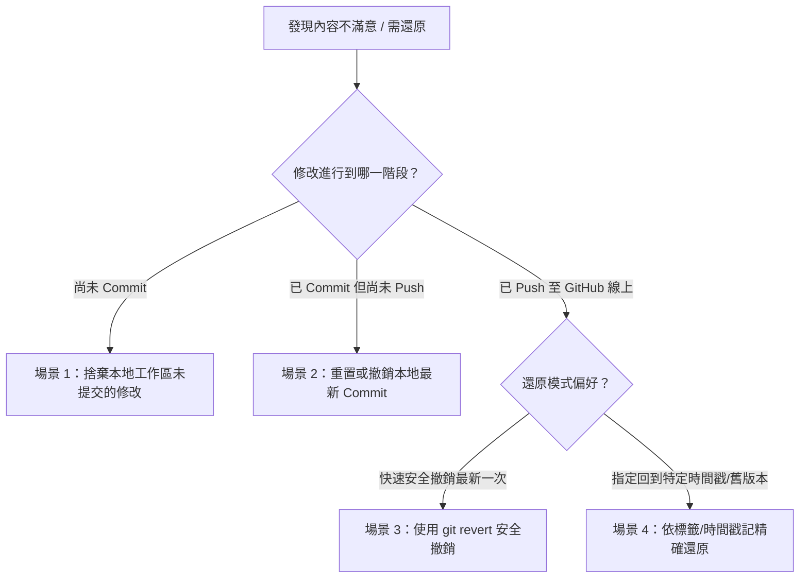

# 奇幻歡樂島 (Website) - GitHub 部署、時間戳版本控管與還原工作流

本工作流程（Workflow）規範「奇幻歡樂島 (website)」專案從修改完成到部署至 GitHub 的標準作業程序。涵蓋自動化時間戳記記錄、Git 標籤版本控管，以及當線上或本地內容不滿意時的完整還原回滾機制。

---

## 快速指令對照表 (Cheat Sheet)

| 情境 | PowerShell 常用指令 | 說明 |
| :--- | :--- | :--- |
| **一鍵部署** | `.\deploy.ps1 -Message "更新故事繪本內容"` | 自動記錄時間戳、Commit、建立 Tag 並推送到 GitHub |
| **檢視歷史** | `git log --oneline --tags --decorate -n 10` | 檢視最近 10 次提交的時間戳記與標籤 |
| **丟棄未提交** | `git restore . ; git clean -fd` | 放棄當前所有尚未 commit 的修改，恢復乾淨狀態 |
| **撤銷最新推播** | `git revert HEAD --no-edit ; git push origin main` | 安全撤銷線上最新一版，自動生成撤銷提交 |
| **一鍵還原舊版** | `.\rollback.ps1` | 互動選單選擇歷史時間戳記進行還原 |

---

## 階段一：前置確認與環境檢查 (Pre-flight Check)

在進行部署前，先確認本地 Git 倉庫狀態與遠端關聯：

```powershell
# 1. 確保位於 website 專案根目錄
Set-Location -Path "d:\JERRY\ME\EGO\AI\website"

# 2. 檢查 Git 狀態
git status

# 3. 檢查遠端儲存庫是否已綁定 GitHub
git remote -v
```

> [!TIP]
> 若尚未初始化 Git 倉庫，請先執行：
> ```powershell
> git init
> git branch -M main
> git remote add origin https://github.com/<您的使用者名稱>/<儲存庫名稱>.git
> ```

---

## 階段二：時間戳記版本控管與部署作業 (Deploy Workflow)

每次發布必須產生不可篡改的時間戳記（Timestamp，格式：`YYYY-MM-DD HH:mm:ss`），並同時寫入發布紀錄檔與 Git Commit/Tag。

### 手動部署標準步驟

#### 步驟 2.1：取得當前時間戳記並記錄至 `DEPLOY_LOG.md`
在專案中追加部署歷史記錄：

```powershell
$timestamp = Get-Date -Format "yyyy-MM-dd HH:mm:ss"
$tagStamp = Get-Date -Format "yyyyMMdd-HHmmss"
$logEntry = "| $timestamp | release-$tagStamp | $env:USERNAME | 網頁內容更新與修訂 |"

# 若 DEPLOY_LOG.md 不存在則初始化表頭，存在則追加記錄
if (-not (Test-Path "DEPLOY_LOG.md")) {
    @"
# 奇幻歡樂島 - 部署與發布時間戳日誌 (Deployment Log)

| 部署時間 (Timestamp) | 發布標籤 (Tag) | 操作者 | 變更摘要 |
| :--- | :--- | :--- | :--- |
"@ | Out-File -FilePath "DEPLOY_LOG.md" -Encoding utf8
}
$logEntry | Out-File -FilePath "DEPLOY_LOG.md" -Append -Encoding utf8
```

#### 步驟 2.2：暫存並提交代碼（包含時間戳記）
```powershell
# 暫存所有修改
git add .

# 提交訊息必須明確標註時間戳記與變更目的
$commitMsg = "deploy: 部署網頁內容更新 [$timestamp]"
git commit -m $commitMsg
```

#### 步驟 2.3：建立時間戳 Git Tag
建立帶有註解的 Annotation Tag，便於日後精準定位還原點：
```powershell
$tagName = "release-$tagStamp"
git tag -a $tagName -m "公開部署發布版本: $timestamp"
```

#### 步驟 2.4：推送到 GitHub 遠端儲存庫
```powershell
# 推送主分支與標籤
git push origin main --tags
```

> [!NOTE]
> 若您使用 GitHub Pages 託管，推送至 `main` 或設定好的 `gh-pages` 分支後，GitHub 官方約在 1~2 分鐘內完成線上建置更新。

---

## 階段三：內容不滿意時的版本還原機制 (Rollback Workflows)

當發布或修改後發現內容不符預期、產生 Bug 或介面走樣時，依據不同的修改狀態採取對應的還原措施：



### 場景 1：尚未 Commit，想直接捨棄剛剛的所有修改
如果編輯完網頁後不滿意，但還沒執行 `git commit`：
```powershell
# 復原所有已修改但未暫存的檔案
git restore .

# 清理所有新增加的未追蹤檔案（強制遞迴清理）
git clean -fd

# 驗證工作區是否已恢復乾淨狀態
git status
```

---

### 場景 2：已經 Commit，但「尚未 Push」到 GitHub
如果剛剛執行了 commit，但還沒推送上雲端，想取消該次提交：

* **選項 A：取消 Commit，但「保留」寫好的程式碼以便重新修改**：
  ```powershell
  git reset --soft HEAD~1
  ```
* **選項 B：徹底丟棄該次 Commit 與所有程式碼變更**：
  ```powershell
  git reset --hard HEAD~1
  ```

---

### 場景 3：已經 Push 到 GitHub，線上已更新（最推薦的安全還原）
代碼已經推送到遠端，此時**切勿直接強制覆蓋歷史**，應使用 `git revert` 產生一個「反向操作」的全新 Commit，既保留稽核軌跡又能立刻使線上網站恢復上一版狀態：

```powershell
# 1. 撤銷最新一次 Commit (自動填寫 revert 訊息)
git revert HEAD --no-edit

# 2. 推送撤銷提交至 GitHub
git push origin main
```
> [!IMPORTANT]
> 執行後，GitHub Pages 會自動觸發新部署，線上網站將立刻回到更新前的狀態。

---

### 場景 4：回溯至歷史特定「時間戳記」或「Tag 標籤版本」
若想退回幾天前或特定時間戳記的穩定版本：

#### 步驟 4.1：列出歷史時間戳標籤
```powershell
# 查看所有發布標籤與說明
git tag -n -l "release-*"

# 或者查看帶有時間戳的提交歷史
git log --graph --pretty=format:'%h - %d %s (%cr) <%an>' -n 10
```

#### 步驟 4.2：精確還原到指定的 Tag
假設您想退回至標籤 `release-20260913-120000`：

* **作法（覆蓋工作區並產生新版本，保持線型歷史完整）：**
  ```powershell
  $targetTag = "release-20260913-120000"

  # 將工作區所有檔案強制恢復成該標籤的檔案內容
  git checkout $targetTag -- .

  # 記錄還原時間戳並提交
  $restoreTime = Get-Date -Format "yyyy-MM-dd HH:mm:ss"
  git commit -m "rollback: 緊急回滾至歷史版本 $targetTag [$restoreTime]"

  # 推送到 GitHub 立即生效
  git push origin main
  ```

---

## 階段四：自動化腳本工具 (PowerShell 輔助程式)

為避免重複手動輸入指令，專案內建兩支自動化 PowerShell 腳本：

### 1. 一鍵部署腳本 (`deploy.ps1`)
在專案根目錄建立 `deploy.ps1`：

```powershell
# deploy.ps1
param (
    [Parameter(Mandatory=$false)]
    [string]$Message = "網頁介面與功能例行更新"
)

$ErrorActionPreference = "Stop"
$now = Get-Date
$timestamp = $now.ToString("yyyy-MM-dd HH:mm:ss")
$tagStamp = $now.ToString("yyyyMMdd-HHmmss")
$tagName = "release-$tagStamp"

Write-Host "🚀 [1/4] 準備部署 website 至 GitHub..." -ForegroundColor Cyan
Write-Host "🕒 時間戳記: $timestamp" -ForegroundColor Yellow

# 更新 DEPLOY_LOG.md
if (-not (Test-Path "DEPLOY_LOG.md")) {
    @"
# 奇幻歡樂島 - 部署與發布時間戳日誌 (Deployment Log)

| 部署時間 (Timestamp) | 發布標籤 (Tag) | 操作者 | 變更摘要 |
| :--- | :--- | :--- | :--- |
"@ | Out-File -FilePath "DEPLOY_LOG.md" -Encoding utf8
}
"| $timestamp | $tagName | $env:USERNAME | $Message |" | Out-File -FilePath "DEPLOY_LOG.md" -Append -Encoding utf8

Write-Host "📦 [2/4] 暫存檔案並建立提交..." -ForegroundColor Cyan
git add .
git commit -m "deploy: $Message [$timestamp]"

Write-Host "🏷️  [3/4] 建立版本標籤: $tagName..." -ForegroundColor Cyan
git tag -a $tagName -m "部署於 $timestamp - $Message"

Write-Host "☁️  [4/4] 推送至 GitHub (main & tags)..." -ForegroundColor Cyan
git push origin main --tags

Write-Host "✅ 部署完成！GitHub Pages 將在數分鐘內更新完畢。" -ForegroundColor Green
```

### 2. 一鍵還原腳本 (`rollback.ps1`)
在專案根目錄建立 `rollback.ps1`：

```powershell
# rollback.ps1
$ErrorActionPreference = "Stop"

Write-Host "================ 歷史發布時間戳記清單 ================" -ForegroundColor Cyan
$tags = git tag -l "release-*" --sort=-creatordate
if (-not $tags) {
    Write-Warning "目前儲存庫尚未建立任何 release-* 標籤！"
    exit
}

$tagList = $tags | Select-Object -First 5
for ($i = 0; $i -lt $tagList.Count; $i++) {
    $t = $tagList[$i]
    $tagMsg = git tag -n1 -l $t
    Write-Host "[$i] $tagMsg" -ForegroundColor Yellow
}
Write-Host "======================================================"

$choice = Read-Host "請輸入要還原的編號 (0-$($tagList.Count - 1))，或按 Q 取消"
if ($choice -match '^[0-9]+$' -and [int]$choice -lt $tagList.Count) {
    $selectedTag = $tagList[[int]$choice]
    $confirm = Read-Host "⚠️ 確定要將目前網頁還原至標籤 [$selectedTag] 嗎？(Y/N)"
    if ($confirm -eq "Y" -or $confirm -eq "y") {
        Write-Host "🔄 正在將檔案狀態恢復至 $selectedTag..." -ForegroundColor Cyan
        git checkout $selectedTag -- .
        $now = Get-Date -Format "yyyy-MM-dd HH:mm:ss"
        git commit -m "rollback: 還原至歷史版本 $selectedTag [$now]"
        git push origin main
        Write-Host "🎉 成功還原並推送到 GitHub！" -ForegroundColor Green
    } else {
        Write-Host "操作已取消。" -ForegroundColor Gray
    }
} else {
    Write-Host "取消操作。" -ForegroundColor Gray
}
```

---

## 總結規範檢核
* 每次推送前確認無本機暫存衝突。
* 嚴禁跳過時間戳記直接使用未經說明的 `git push -f`。
* 任何線上緊急還原優先使用 `git revert` 或 `rollback.ps1`。
