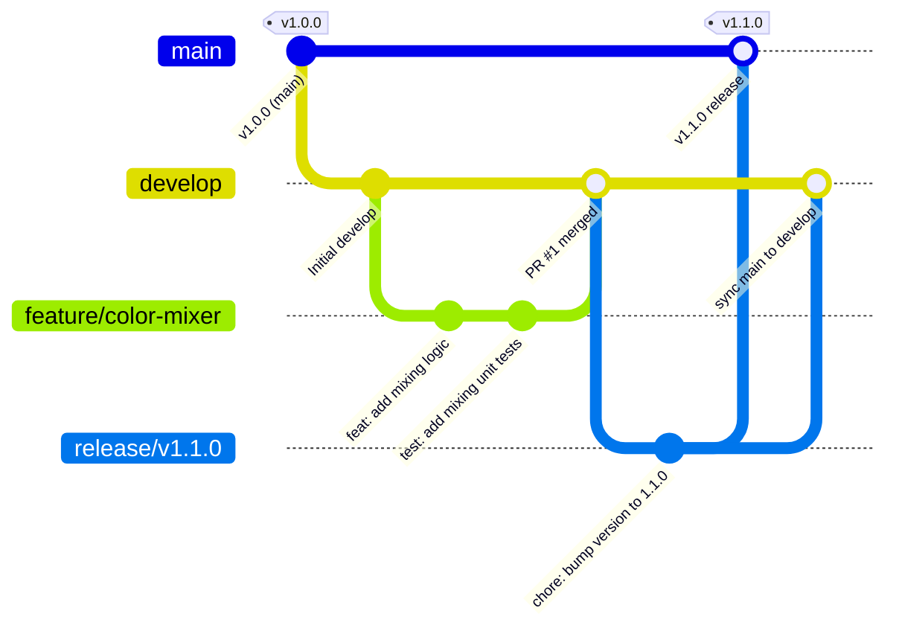
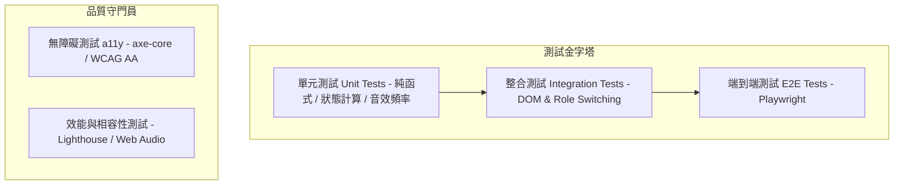

# 奇幻歡樂島 (Wonderland Island) - 公開主題互動教育網站


「奇幻歡樂島」是一座專為**兒童、家長與教育工作者（幼教與國小老師）**打造的童趣沈浸式公開主題互動網站。整體架構堅持零外部肥大相依（Zero Dependencies），以現代原生 Web 技術（Semantic HTML5、CSS 現代變數與動畫、ES6+ 模組化物件導向、Web Audio API 與 Web Speech API）構建，具備輕量、高速載入、極致安全與跨裝置響應等特性。

---

## 目錄 (Table of Contents)
1. [專案架構與特色](#1-專案架構與特色)
2. [目錄結構說明](#2-目錄結構說明)
3. [版本控管規範 (Version Control & Git Workflow)](#3-版本控管規範-version-control--git-workflow)
4. [完整測試體系 (Comprehensive Testing Strategy)](#4-完整測試體系-comprehensive-testing-strategy)
5. [CI/CD 自動化管線 (CI/CD Pipeline)](#5-cicd-自動化管線-cicd-pipeline)
6. [本地端開發與啟動 (Local Development)](#6-本地端開發與啟動-local-development)
7. [公開部署維運指引 (Public Deployment)](#7-公開部署維運指引-public-deployment)

---

## 1. 專案架構與特色

### 1.1 三重角色視角動態切換
系統提供一鍵即時角色切換機制，透過 `document.body.dataset.role` 切換全站 UI 主題與導引內容：
* 🧒 **兒童模式 (Kids Mode)**：大圖形按鈕、鮮豔色彩、即時回饋音效、微粒彩帶獎勵與動態成就徽章。
* 👨‍👩‍👧 **家長模式 (Parents Mode)**：護眼計時提醒、親子共讀與延伸提問對話錦囊、居家 STEAM 活動手冊。
* 👩‍🏫 **老師模式 (Teachers Mode)**：STEAM 素養指標對照、課堂小組分組討論題綱、大螢幕投影互動優化。

### 1.2 核心板塊模組
* 🎪 **歡樂大廳 (Lobby)**：特色看板、成就星星與徽章展櫃、每日驚喜禮物盒。
* 📖 **奇幻故事島 (Story Island)**：分幕圖文繪本、Web Speech API 語音朗讀、動態探索對話。
* 🧸 **魔法玩具箱 (Toys)**：
  * **彩色鐵琴**：基於 Web Audio API 振盪器（Oscillator）即時合成純音階（C4~C5），無音頻檔載入延遲。
  * **調色實驗室**：紅黃藍三原色合成奇幻精靈演算法。
  * **創客手作圖鑑**：環保紙箱與寶特瓶手作教學。
* 🎮 **萌寵遊樂場 (Games)**：
  * **記憶翻牌遊戲**：動態隨機洗牌、配對演算法與星等結算。
  * **氣球消消樂**：計時反應力挑戰。
  * **彩虹塗鴉板**：HTML5 Canvas 向量繪畫、粗細切換與一鍵儲存下載。
* 💡 **萬物好奇小百科 (Knowledge)**：語音探索百科、STEAM 科普問答挑戰賽。
* ⏱️ **護眼計時與成就系統**：本地端 `localStorage` 狀態持久化，定期主動提醒視力保健。

---

## 2. 目錄結構說明

```text
website/
├── css/
│   ├── animations.css    # 漂浮雲朵、星星閃爍、微粒彩帶、搖擺等微動效
│   ├── components.css    # 鐵琴、卡片、調色皿、畫板、彈窗等模組化樣式
│   └── style.css         # 全域變數 (CSS Tokens)、排版格線、響應式斷點
├── js/
│   ├── app.js            # AppManager: 主協調器、角色切換、星星與徽章
│   ├── sound.js          # SoundEngine: Web Audio 合成音效、Web Speech 朗讀
│   ├── story.js          # StoryManager: 繪本展示、語音朗讀、親子思考題
│   ├── toys.js           # ToysManager: 8音鐵琴、調色實驗室、DIY創客
│   ├── games.js          # GamesManager: 記憶翻牌、氣球消消樂、Canvas 塗鴉板
│   └── knowledge.js      # KnowledgeManager: 萬物百科科普知識、互動問答
├── index.html            # 單頁應用首頁（語意化 HTML5 與 SEO 優化）
└── README.md             # 專案架構、測試與版本控管說明文件
```

---

## 3. 版本控管規範 (Version Control & Git Workflow)

為確保公開網站能持續高質量發布，並支援多人協作與即時熱修復，本專案實施嚴格的版本控管標準。

### 3.1 分支策略 (Branch Strategy)
採用 **Trunk-based 與 Git Flow 融合模型**：



* `main`：**正式生產分支**。此分支必須隨時處於可直接部署狀態，直接對應線上公開網址。受分支保護（Protected Branch），禁止直接推送，必須經由 PR 審核並通過自動化檢查。
* `develop`：**開發整合分支**。所有新功能與一般修復皆匯入此分支，作為預發布整合驗證環境。
* `feature/<feature-name>`：**新功能分支**。從 `develop` 簽出，開發完成後發起 PR 合併回 `develop`。例如：`feature/audio-recorder`。
* `fix/<bug-description>`：**缺陷修復分支**。從 `develop` 簽出，修復非緊急問題。
* `hotfix/<version>`：**線上緊急修復分支**。當 `main` 線上版本發現重大問題時，直接從 `main` 簽出，修復後同時合併回 `main` 與 `develop`。
* `release/vX.Y.Z`：**版本發布準備分支**。進行發布前凍結測試、文件更新與版本號升級。

### 3.2 Commit 訊息規範 (Conventional Commits)
每次 Commit 必須遵循 Angular / Conventional Commits 格式：
```text
<type>(<scope>): <subject>

[optional body]

[optional footer(s)]
```

#### Type 定義清單
| Type | 說明 | 範例 |
| :--- | :--- | :--- |
| **`feat`** | 新增功能或主題板塊 | `feat(toys): 新增木琴第9音階與鍵盤按鍵對應` |
| **`fix`** | 修復功能缺陷或邏輯錯誤 | `fix(sound): 修正 Safari 下 AudioContext 未解鎖問題` |
| **`docs`** | 僅變更文件或說明內容 | `docs(readme): 補充 E2E 測試與跨瀏覽器指引` |
| **`style`** | 不影響代碼含義的格式調整（空白、縮排、分號） | `style(css): 統一組件間距與 CSS 變數命名` |
| **`refactor`** | 代碼重構（非新功能亦非修復） | `refactor(games): 重構記憶翻牌演算法為純函式` |
| **`perf`** | 提升執行效能或降低記憶體消耗 | `perf(canvas): 優化畫布筆觸 requestAnimationFrame 節流` |
| **`test`** | 新增或修訂測試案例 | `test(app): 補充角色切換與 LocalStorage 整合測試` |
| **`chore`** | 建置工具、CI 設定、依賴維護 | `chore(ci): 新增 GitHub Actions Lighthouse 效能自動掃描` |

### 3.3 語意化版本號 (Semantic Versioning 2.0.0)
版本號遵循 `MAJOR.MINOR.PATCH` 規則：
1. **MAJOR (主版本號)**：不相容的大型改版（如架構全面替換、資料存儲結構重大變更無法向下相容）。
2. **MINOR (次版本號)**：向下相容的功能性新增（如新增一組遊樂場小遊戲、擴充調色配方）。
3. **PATCH (修訂號)**：向下相容的問題修復（如修復破圖、修正文字語音朗讀停止事件異常）。

#### 發布標籤指令範例
```bash
# 建立帶有說明文件的簽名發布標籤
git tag -a v1.1.0 -m "Release v1.1.0: 擴充萬物小百科科普題庫與家長護眼提醒優化"

# 推送至遠端儲存庫
git push origin v1.1.0
```

### 3.4 Pull Request (PR) 審核標準清單
在 PR 合併前，至少需獲得 1 位技術審查員（Reviewer）核准，且須逐項確認：
* [ ] 本地執行無任何 Console Error / Warning。
* [ ] 所有單元測試與端到端測試 100% 通過。
* [ ] 程式碼遵循無外部相依原則，嚴禁未經審查引入第三方 CDN 腳本。
* [ ] 響應式佈局通過手機（375px）、平板（768px）與桌面（1280px+）檢驗。
* [ ] 符合 WCAG 2.1 AA 無障礙標準（鍵盤可存取、對比度符合規範）。

---

## 4. 完整測試體系 (Comprehensive Testing Strategy)

針對本專案具備「強互動性、純原生音效、Canvas 繪圖、本地持久化與多角色動態切換」等特性，建立五維度完整測試體系：



### 4.1 單元測試 (Unit Testing)
針對無狀態純函式、演算法、常數映射表與狀態計算邏輯進行覆蓋。
* **主要測試標的**：
  * `ToysManager.notesMap` 頻率精準度（例如 C4=261.63Hz, A4=440.00Hz）。
  * 調色實驗室配方演算法（如 `['red', 'blue'] => 'purple'`）。
  * 記憶翻牌洗牌演算法（Fisher-Yates Shuffle 均勻分佈與成對驗證）。
  * 護眼時間倒數計時計算純函式。

#### 單元測試範例 (使用 Vitest / Node.js 測試環境)
```javascript
// tests/unit/toys.test.js
import { describe, it, expect } from 'vitest';

describe('魔法玩具箱 (ToysManager) 邏輯測試', () => {
  const notesMap = {
    "C4": { freq: 261.63, name: "Do" },
    "A4": { freq: 440.00, name: "La" }
  };

  it('標準音 A4 之基準頻率應為 440.00 Hz', () => {
    expect(notesMap["A4"].freq).toBeCloseTo(440.00, 2);
  });

  it('調色混色演算法：紅 + 藍 應正確合成 紫色奇幻夜光貓', () => {
    function mixColors(colorA, colorB) {
      const set = new Set([colorA, colorB]);
      if (set.has('red') && set.has('blue')) return { name: '夜光紫貓', color: '#9b5de5' };
      if (set.has('red') && set.has('yellow')) return { name: '暖暖橙橘獸', color: '#f15bb5' };
      return null;
    }

    const result = mixColors('red', 'blue');
    expect(result).not.toBeNull();
    expect(result.name).toBe('夜光紫貓');
  });
});
```

### 4.2 DOM 與狀態整合測試 (Integration Testing)
驗證各子模組與 DOM 元素、`localStorage` 及全域事件的協同運作：
* **角色切換驗證**：切換至 `parents` 時，`document.body.dataset.role` 應為 `parents`，且頂部 Banner 內容動態變更為家長模式導引。
* **分頁切換**：點擊各 Tab 時，其餘分頁面板必須加上 `hidden` 屬性或切換展示狀態，當前 Tab 加上 `.active`。
* **成就系統持久化**：獲得徽章時，`localStorage` 中的 `wl_badges` 與 `wl_stars` 數值正確同步更新。

### 4.3 端到端測試 (End-to-End, E2E Testing)
使用 **Playwright** 模擬使用者真實操作情境，驗證跨瀏覽器（Chromium、Firefox、WebKit/Safari）行為。

#### E2E 測試案例腳本範例
```typescript
// tests/e2e/user-journey.spec.ts
import { test, expect } from '@playwright/test';

test.describe('奇幻歡樂島核心使用者旅程', () => {
  test.beforeEach(async ({ page }) => {
    await page.goto('http://localhost:8080');
  });

  test('首頁正常載入，預設為兒童模式', async ({ page }) => {
    await expect(page).toHaveTitle(/奇幻歡樂島/);
    const bodyRole = await page.locator('body').getAttribute('data-role');
    expect(bodyRole).toBe('kids');
  });

  test('角色切換為家長模式後，顯示護眼計時導引', async ({ page }) => {
    // 點擊家長模式按鈕
    await page.click('#roleBtnParents');
    
    // 驗證 body 屬性更新
    await expect(page.locator('body')).toHaveAttribute('data-role', 'parents');
    // 驗證家長專屬橫幅內容
    await expect(page.locator('#roleBannerTitle')).toContainText('護眼計時器已啟動');
  });

  test('敲擊鐵琴發出音效並正確增加敲擊次數統計', async ({ page }) => {
    // 切換至魔法玩具箱 Tab
    await page.click('#tabToys');
    // 點擊第一個鐵琴按鍵 (Do - C4)
    const doKey = page.locator('.xylo-key[data-note="C4"]');
    await expect(doKey).toBeVisible();
    await doKey.click();
    // 驗證按鍵反饋動畫 class
    await expect(doKey).toHaveClass(/playing/);
  });
});
```

### 4.4 無障礙與身心障礙友善測試 (Accessibility / a11y)
公開主題教育網站特別著重孩童與各類輔助技術使用者的友善體驗，嚴格遵循 **WCAG 2.1 AA** 標準：
1. **色彩對比度**：文字與背景色對比度皆高於 `4.5:1`，避免僅用色彩傳遞關鍵資訊。
2. **鍵盤導航 (Keyboard Nav)**：全站所有按鈕與分頁支援 `Tab` 與 `Shift + Tab` 聚焦，並有明顯的 `:focus-visible` 外框。
3. **無障礙朗讀支援**：裝飾性幾何元素加上 `aria-hidden="true"`，關鍵動態區域配置 `aria-live="polite"`。
4. **自動化檢測工具**：整合 `@axe-core/playwright` 於 CI 流程中，不允許存在嚴重的 a11y 違規。

### 4.5 跨瀏覽器相容性與 AudioContext 授權政策 (Cross-Browser Audits)
* **Web Audio Autoplay Policy 測試**：
  現代瀏覽器（特別是 Safari 與 Chrome）嚴格限制未經手勢觸發的音頻播放。本系統在 `SoundEngine.initAudioContext()` 中設計延遲初始化與手勢喚醒機制（首次點擊即 `ctx.resume()`），需在 iOS Safari、iPadOS 與各 Android 裝置上實機驗證。
* **Web Speech API 支援降級**：
  若瀏覽器未實作 `window.speechSynthesis`，系統自動隱藏朗讀按鈕或改以靜態提示，確保核心探索功能不中斷。

---

## 5. CI/CD 自動化管線 (CI/CD Pipeline)

透過 GitHub Actions 建立零接觸自動化檢查與發布管線：

```yaml
# .github/workflows/ci.yml
name: CI/CD Quality Gate & Deployment

on:
  push:
    branches: [ main, develop ]
  pull_request:
    branches: [ main, develop ]

jobs:
  validate:
    runs-on: ubuntu-latest
    steps:
      - name: 下載原始碼
        uses: actions/checkout@v4

      - name: 設定 Node.js 環境
        uses: actions/setup-node@v4
        with:
          node-version: 20

      - name: 安裝測試工具
        run: npm ci

      - name: 靜態程式碼檢查與 HTML/CSS 語法驗證
        run: |
          npx htmlhint index.html
          npx stylelint "css/**/*.css"

      - name: 執行單元測試 (Unit Tests)
        run: npm run test:unit

      - name: 執行 Playwright E2E 測試與 a11y 無障礙檢驗
        run: |
          npx playwright install --with-deps
          npm run test:e2e

      - name: 執行 Google Lighthouse CI 跑分檢驗
        uses: treosh/lighthouse-ci-action@v11
        with:
          urls: 'http://localhost:8080'
          assertions: |
            categories:performance: ["error", {"minScore": 0.90}]
            categories:accessibility: ["error", {"minScore": 0.95}]
            categories:best-practices: ["error", {"minScore": 0.95}]

  deploy:
    needs: validate
    if: github.ref == 'refs/heads/main' && github.event_name == 'push'
    runs-on: ubuntu-latest
    steps:
      - name: 下載原始碼
        uses: actions/checkout@v4

      - name: 部署至 GitHub Pages (公開靜態網站)
        uses: peaceiris/actions-gh-pages@v3
        with:
          github_token: ${{ secrets.GITHUB_TOKEN }}
          publish_dir: ./
          publish_branch: gh-pages
```

---

## 6. 本地端開發與啟動 (Local Development)

本專案無需編譯步驟，使用任何輕量 HTTP 靜態伺服器即可啟動開發環境：

### 6.1 使用 PowerShell 啟動方式 (Windows 環境)

#### 方法 A：使用 Python 內建伺服器
```powershell
# 進入網站專案目錄
Set-Location -Path "d:\JERRY\ME\EGO\AI\website"

# 啟動輕量 HTTP 伺服器 (通訊埠 8080)
python -m http.server 8080
```
瀏覽器開啟：`http://localhost:8080`

#### 方法 B：使用 Node.js 輕量伺服器 (`npx serve` 或 `http-server`)
```powershell
# 透過 npx 直接啟動免安裝伺服器
npx serve -l 8080 .
```

#### 方法 C：VS Code / Antigravity IDE 擴充
使用 `Live Server` 擴充套件，在 `index.html` 按右鍵點擊 **"Open with Live Server"**。

---

## 7. 公開部署維運指引 (Public Deployment)

本專案純純靜態檔案（HTML + CSS + JS），適合部署至任何現代邊緣 CDN 託管平台：

1. **GitHub Pages**：
   * 在專案 Settings > Pages 中，將 Source 設定為 `main` 分支的 `/` (root) 或 `gh-pages` 分支。
   * 免費提供 HTTPS 憑證與自訂網域名稱 (Custom Domain) 支援。
2. **Cloudflare Pages**：
   * 連接 GitHub 儲存庫，Build command 留空，Output directory 設為 `/`。
   * 享有全台 Cloudflare Anycast CDN 加速與 DDOS 防護。
3. **安全防護政策 (Content Security Policy, CSP)**：
   若透過伺服器或邊緣節點發布，推薦配置以下 HTTP Header：
   ```http
   Content-Security-Policy: default-src 'self'; script-src 'self' 'unsafe-inline'; style-src 'self' 'unsafe-inline'; img-src 'self' data:; media-src 'self';
   X-Content-Type-Options: nosniff
   X-Frame-Options: SAMEORIGIN
   Referrer-Policy: strict-origin-when-cross-origin
   ```

---

## 8. 授權條款 (License)
本主題網站以 [MIT 授權條款](LICENSE) 開源釋出。歡迎用於非營利親子活動、學校公開教學與 STEAM 實務展示。
